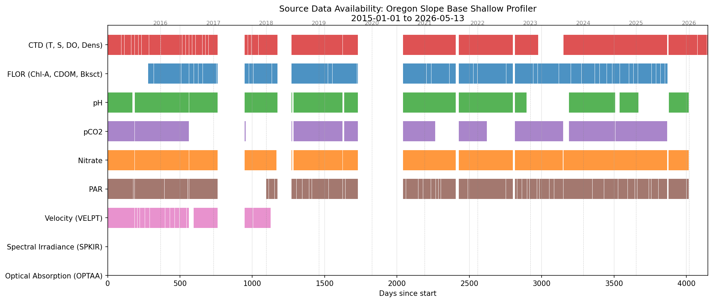

# Developer Guide

> **New here?** Read the big picture in `ArgosyOverview.md`. This guide is a technical map
> for a collaborator ("Chuck") or a separate research program ("Angus") ready to dive in
> to Argosy. Concerning the working environment and data access: Consult `SETUP.md`.


This document describes the repository and data filesystem layout, and the end-to-end
workflow from data ordering (Phase 1) through analysis (Phase 2). For the exhaustive file
inventory see the generated file inventory (`python tools/gen_manifest.py`; handout in `poster/agumemo.md`); for one-off operational commands (build/publish, per-file
PDF, standalone widgets) see the `operational-recipes` steering file.


## gpi2fnm

`~/argosy/gpi2fnm.py` resolves a **Global Profile Index (GPI)** to that profile's metadata
and the pp06 shard filename for every sensor. A GPI names one shallow-profiler profile at a
site; each profile has one shard per sensor, so the tool returns all of them.

Run it in the `argosy` conda env:

```bash
source ~/miniconda3/etc/profile.d/conda.sh && conda activate argosy

python ~/argosy/gpi2fnm.py --gpi 2047                 # Slope Base (sb) is the default
python ~/argosy/gpi2fnm.py --gpi 16509 --location ab  # Axial Base; or --location oo
python ~/argosy/gpi2fnm.py --gpi 2047 --json          # machine-readable JSON
python ~/argosy/gpi2fnm.py --gpi 2047 --paths         # also list pp06 files present on disk
```

`--location` (alias `--site`) takes `sb` (default), `oo`, or `ab`. Example output:

```
GPI 74  site sb (RS01SBPS)
  date 2015-10-09  day-of-year 282  daily index 3 of 9
  ascent  2015-10-09T14:44:00 -> 2015-10-09T15:37:00  (53.0 min)
  descent 2015-10-09T15:37:00 -> 2015-10-09T17:00:00  (83.0 min)
  pp06 shard filenames (11 sensors):
    temperature      RCA_sb_sp_temperature_2015_282_74_3_V1.nc
    salinity         RCA_sb_sp_salinity_2015_282_74_3_V1.nc
    ... (density, dissolvedoxygen, chlora, cdom, backscatter, par, nitrate, ph, pco2)
```

The GPI → (date, time, daily index) mapping comes from the site's `profileIndices` tables
(`ooipaths.profile_index_dir`); a GPI outside the available range prints an error with the
valid range. `--paths` reports which of the 11 sensor files actually exist locally (e.g. a
profile may have no nitrate/pH/pCO2 shard).

**Reuse in your own code** — the logic lives in a function that returns a dict, so import it
rather than shelling out:

```python
from gpi2fnm import resolve_gpi           # run from ~/argosy, or add it to sys.path
info = resolve_gpi(2047, site="sb")
info["date"]                              # '2015-...'
info["daily_index"]                       # 1..9
info["filenames"]["temperature"]          # 'RCA_sb_sp_temperature_...nc'
info["start"], info["peak"], info["end"]  # ISO UTC profile times
```


## Two-phase structure


We want to distinguish between the process of getting and cleaning the data (Phase 1) from
the analysis of that data (Phase 2).


- **Phase 1 — Pipeline:** raw OOINET data → sharded `redux` → quality-controlled analysis-ready
  `pp06` (and annotated derivatives). Workflow tasks 0–3 + 6 below. Docs: this guide,
  `Sharding.md`, `PostProcessing.md`, `PP05_QCAnalysis.md`, `DataOps.md`, `VectorData.md`.
- **Phase 2 — Analysis:** anomaly coincidence, residual climatology, spectral graph analysis,
  internal waves, Columbia plume (the plume study), and cross-comparison with satellite (CRW SST
  and SMAP SSS via NOAA CoastWatch ERDDAP; ocean color planned). Tasks 4–5. Docs: `Analysis.md`,
  `SpectralGraphAnalysis.md`, `InternalWaves.md`, `plume/ColumbiaPlumePlan.md`, `tides/TidalAnalysis.md`,
  `CoincidencePlans.md`.

Argosy starts with the Oregon Slope Base (`sb`) shallow profiler; a near-term goal is bringing
Oregon Offshore (`oo`) and Axial Base (`ab`) to the same stage.


## Filesystem layout


We have a Jupyter Book (plus working code): A GitHub repo; and to keep the repo size manageable we have a separate data directory. That is: We work from two independent directory trees: the repository (`~/argosy`, code + markdown, GitHub) and the data (`~/ooi`, NetCDF + derived products, mirrored to S3). The data footprint in `~/argosy` is light, for example `~/argosy/images/` holds copies of charts for the book/PDF.


To manage file paths we have a Python library `ooipaths.py`. **All path knowledge is centralized in `ooipaths.py`** found in the repo root. Other code uses this library to generate paths. For example `op.redux_dir(year, site)` will provide a path to a redux sub-folder given a site of interest and a year. `<site>` is a 2-letter code (`sb`/`oo`/`ab`) corresponding to the three OOI shallow profilers, respectively Oregon Slope Base, Oregon Offshore (Endurance), and Axial Base.


```
~/argosy/                         repository (Jupyter Book + working scripts/markdown)
    chapters/                     Jupyter Book executable notebooks
    ooipaths.py                   single source of truth for data paths

~/ooi/                            data root
    <site>/                       sb (Slope Base), oo (Oregon Offshore), ab (Axial Base)
        ooinet/                   raw OOINET source NetCDF
            scalar/<yyyy>_<instrument>/    e.g. sb/ooinet/scalar/2016_nitrate
            vector/<yyyy>_<instrument>/    velocity, spectral irradiance, optical absorption, beam attenuation
        redux/<yyyy>/             sharded profiles (one NetCDF per sensor per profile)
        postproc/<pp>/<yyyy>/     post-processing results (pp01, pp02, pp05, pp06, ...)
        profileIndices/           profile ascent/descent timestamps (clone from GitHub, designator-keyed CSVs)
        metadata/                 derived metadata, in subfolders (qc, profiles, features, annotations, external, cache, scans)
        analysis/<method>/        analysis outputs (sga, clustering, ...)
        visualizations/           saved charts (histograms, etc.)
```

Raw `ooinet` for `sb` is ~204 GB (archived to S3, deletable locally); `redux` ~18 GB; `pp06`
~15 GB. See `DataOps.md` for S3 layout, sync/restore, and local disk management.


## Workflow (tasks 0–6)

- **(0) Manual:** order datasets through the OOINET browser interface (see below).
- **(1) Automated — Download:** retrieve NetCDF from the OOINET staging URLs into
  `~/ooi/<site>/ooinet/{scalar|vector}/<yyyy>_<instrument>/`. Code: `pipeline/download.py`.
  Includes a step to scan for and delete superfluous (time-overlapping) source files.
- **(2) Automated — Sharding:** break source files into single-sensor, single-profile shards in
  `~/ooi/<site>/redux/<yyyy>/`. Code: `chapters/DataSharding.ipynb`. Also generates the
  midnight/noon profile lists. See `Sharding.md`.
- **(3) Automated — Post-processing:** evaluate/filter shards into `~/ooi/<site>/postproc/pp<NN>/<yyyy>/`.
  See `PostProcessing.md` and `PP05_QCAnalysis.md`.
- **(4) Interactive — Visualizations:** bundle charts, curtain plots, animations. See `Visualization.md`.
- **(5) Interactive — Analysis:** SGA, clustering, coincidence, etc. See `Analysis.md` (Phase 2).
- **(6) Mirror to S3:** reproducibility/portability. See `DataOps.md`.


## Task 0/1 detail — ordering and downloading from OOINET

### Order datasets from OOINET (manual)

- Log in to the OOI [access page](https://ooinet.oceanobservatories.org/data_access).
- Left-hand filters: Array, Cable, Platform, Instrument.
- In the Data Catalog box: use the **+** action to add datasets to the download table.
  - **Do not use the time-window interface** in the catalog.
  - Selections will appear in a Data Navigation table (top center of browser page)
  - Select datasets with **Stream type == `Science`**.
  - Select the download button to raise an order dialog box
  - Use profileIndices to identify the start day of operations; for example Oregon Offshore started operation on 03-AUG-2015
  - Using checkboxes enable "Include Provenance" and "Include Annotations"
- Click **Download** → finalize the order:
  - Type the time range manually, e.g. `2015-01-01 00:00:00.0`.
  - Optionally uncheck **Download All Parameters** and ctrl-click specific parameters.
  - Submit; an "order ready" email (with staging URLs) usually arrives in under ~2 hours.

### Download the order

URLs go into `~/argosy/download_link_list.txt` (one per line; `#`-prefixed lines ignored).
`pipeline/download.py` reads each URL, reports how many `.nc` files are present / already
downloaded / remaining, and downloads the missing ones (restart-tolerant). Files route to the
destination folder by the year parsed from the filename's first timestamp. `.ncml` files are
ignored.

### Raw filename anatomy

Example:
`deployment0004_RS01SBPS-SF01A-2A-CTDPFA102-streamed-ctdpf_sbe43_sample_20180208T000000.840174-20180226T115959.391002.nc`

- `deployment0004` — operational deployment (months–year between maintenance)
- `RS01SBPS` — reference designator: `RS`=Regional Cabled Array, `SB`=Slope Base, `PS`=Profiler Shallow
- `SF01A` — the profiler (not the fixed platform)
- `CTDPFA102` — CTD instrument (yields temperature, salinity, density, dissolved oxygen shards)
- `20180208T...-20180226T...` — UTC data time range
- `.nc` — NetCDF

These source files are dense amalgams (sensor + engineering + QC data, hundreds of MB,
many profile cycles). The pipeline reduces them to per-sensor per-profile shards.

Common xarray first step (raw dimension is `obs`; we swap to `time`):
```python
ds = ds.swap_dims({'obs': 'time'})
```
Keep `time`, `depth`, and the science variable(s); drop `lat`/`lon` (near-constant for a
shallow profiler) and engineering variables not needed downstream.

### Degenerate source files

Because CTD files are delivered alongside other instrument orders, downloading pH/pCO2/nitrate
can pull duplicate CTD files. Cells 2–3 of the retired `DataDownload` notebook (recover with `git show f344e09:chapters/DataDownload.ipynb`) detected source files whose time
range is covered by other file(s) and script their deletion (time ranges are in the filenames).


## Shard filename convention

`RCA_<site>_sp_<sensor>_<yyyy>_<ddd>_<global_index>_<daily_index>_<version>.nc`
e.g. `RCA_sb_sp_temperature_2018_296_6261_7_V1.nc`

- `RCA` Regional Cabled Array · `<site>` 2-letter site · `sp` shallow profiler
- `<sensor>` from the sensor table `shard` column
- `<yyyy>` year · `<ddd>` Julian day · `<global_index>` per-site profile counter (from `profileIndices`)
- `<daily_index>` 1–9 (which profile of the day) · `<version>` V1 redux, V2 postproc subsets

Each shard carries `depth` (metres) and `time` as coordinates plus the single sensor data
variable. Pressure is NOT stored; derive it from depth (`gsw.p_from_z`) when needed — see
`Sharding.md` → "Depth and pressure" (e.g. for Holte & Talley MLD, which works in dbar).

See `Sharding.md` and `SensorTable.md` for details.


## Source data coverage

Presence/absence of source files by instrument across the timeline (generated by cell 5 of the retired `DataDownload` notebook):




## S3 mirror (task 6, summary)

The `~/ooi` tree mirrors to `s3://s3ooi/` (per-site prefixes; raw `ooinet/` kept under legacy
keys). `DataOps.md` is authoritative for sync/verify/restore commands and the public-read
bucket policy. Quick form:
```bash
aws s3 sync ~/ooi/sb/redux/    s3://s3ooi/sb/redux/
aws s3 sync ~/ooi/sb/postproc/ s3://s3ooi/sb/postproc/
```


## Sharing small datasets

`~/ooi` is not in git, but a few datasets are tiny and need to reach collaborators; today that
means the human MLD label CSVs (science + training, well under 1 MB). The workaround is a
repo-side staging folder, `~/argosy/shared_labels/`, plus `sync_labels.py`, which copies label
files between that folder and `~/ooi/<site>/metadata/annotations/`. The labeler *pushes* into the
folder and commits it; the collaborator pulls the repo and *pulls* from the folder into her own
`~/ooi`. The copy is a merge, not an overwrite: rows are keyed by (gpi, sensor, who) and the later
`reviewed_at` wins, so re-running is harmless and different labelers (R, C) never touch each
other's files. Limitation: a label removed with "Clear pick" is not removed on the other side.
It is a kluge, but a safe one for files this small. Details: `shared_labels/README.md`.

Labeler (after annotating):

```bash
python ~/argosy/sync_labels.py push --dry-run   # preview what would be copied/merged
python ~/argosy/sync_labels.py push
cd ~/argosy && git add shared_labels && git commit -m "labels" && git push
```

Collaborator (to see them in `MLDTimeSeries.py`):

```bash
cd ~/argosy && git pull
python ~/argosy/sync_labels.py pull
python ~/argosy/MLDTimeSeries.py
```

Options for both directions: `--site <sb|oo|ab>`, `--who <R|C>`. Only use this for small files; large
data belongs in S3 (see "S3 mirror" above).


## Where to go next

- Extend to a new site (`oo`/`ab`): run tasks 0–3 with `site=` set; `ooipaths` handles paths.
- Analysis methods: `Analysis.md` and the Phase 2 docs.
- Reuse / cite the work: `SETUP.md` (get running) and `Publishing.md` (DOIs, data access).
