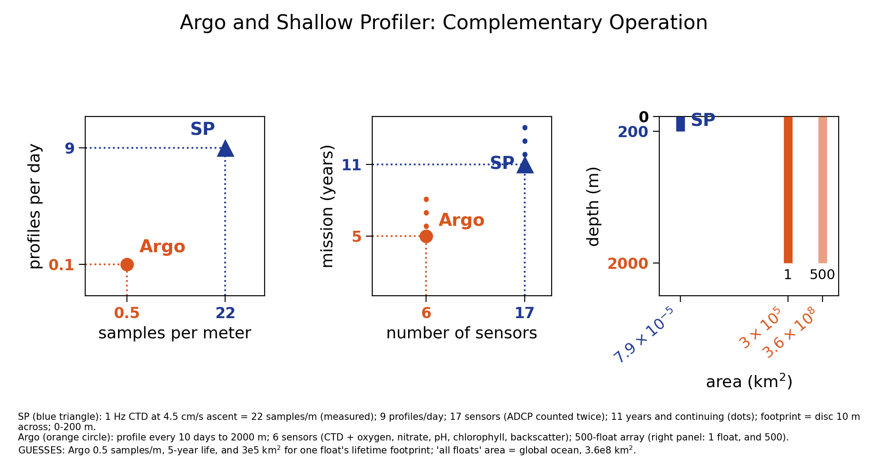

# argosy: project review and AGU26 poster guide

Handout, November 2026 (draft 1). Part I describes the project in one page. Part II is a manifest
of the sub-projects in the order the data flows, each with a status label. Part III is the
technical guide for the AGU26 poster. This file lives in `~/argosy/poster/`; it is not part of the
Jupyter Book.


## Part I. The project in one page

**What argosy is.** A research narrative in book form and, at the same time, a working environment
for analyzing data. It starts with the three shallow profilers of the NSF Ocean Observatories
Initiative (OOI) Regional Cabled Array: Slope Base (`sb`), Oregon Offshore (`oo`) and Axial Base
(`ab`). Each profiler climbs and descends the upper 200 m about nine times a day and has done so
since 2015. Argosy turns that record into analysis-ready data and then asks what the ocean is like
on average and what departs from average.

**Two phases.**

- **Phase 1, pipeline:** raw OOI files -> one file per profile per sensor (`redux`) -> a list of valid
  profiles (`pp05`) -> filtered, analysis-ready profiles (`pp06`). Done for all three sites.
- **Phase 2, interpretation:** mixed layer depth, the subsurface oxygen maximum, internal waves,
  clustering of water-column regimes, and comparison with outside data (weather, Argo, satellites).

**Two chambers.** The *Jupyter Book* is the reader-facing Phase 2 narrative (published on GitHub
Pages). The *working environment* is everything else: pipeline code, QC tools, planning documents.
Sub-project folders hold the code and notes for one topic each; `chapters/` holds the Book's notebooks.

**Where things live.**

| Place | Holds |
|---|---|
| `~/argosy` (GitHub: robfatland/argosy) | code, documents, small hand-kept metadata; never bulk data |
| `~/ooi/<site>/...` | all data: raw (`ooinet`), `redux`, `postproc`, `metadata`, `analysis`, `visualizations` |
| S3 bucket `s3ooi` | backup of `~/ooi`; only `pp06` is public |
| Zenodo (community `nsf-ooi`) | published datasets, for example the MLD training labels |
| `~/prototype-userguide` (separate repo) | an AI-readable user guide for OOI data, with a catalog of the Zenodo community |

Every script gets its data paths from one file, `ooipaths.py`; nothing hard-codes a data path.

**Status labels.** Every folder README starts with a status line:

- **active**: worked on in the last couple of months, or needed by the running pipeline.
- **paused**: real work exists and is on hold on purpose; the README says how to restart.
- **stub**: begun but little real work, or superseded; a candidate to grow or to retire.


## Part II. Manifest of sub-projects

Listed in the order the data flows: get it, look at it, interpret it, compare it with the outside
world, share it. Each folder's own `README.md` has the file list and the next step.
(Retired: `NDBC/`, a stub, removed Nov 2026; see `seastate/README.md`.)

<!-- MANIFEST:START -->

**A. Get the data (Phase 1)**

| Folder | Status | Purpose |
|--------------|--------|------------------------------------------------------------|
| `pipeline/` | active | Phase 1 pipeline: download, shard, post-process to pp06, sync to S3 |
| `cloud/` | active | disposable EC2 pipeline runner (CDK) and the S3 public-access and budget guard scripts |
| `visqc/` | paused | Phase 1 human QC tools: sign off or discard scalar sensor data profile by profile |

**B. Look at the data**

| Folder | Status | Purpose |
|--------------|--------|------------------------------------------------------------|
| `vis/` | active | plotting scripts behind the Visualizations notebook: bundle chart, curtain plots, bundle animation, MLD coverage |
| `chapters/` | active | the Jupyter Book's executable notebooks (Phase 2 analysis chapters) |
| `images/` | active | key figures embedded in the docs, the Book and the PDFs |

**C. Interpret the data (Phase 2)**

| Folder | Status | Purpose |
|--------------|--------|------------------------------------------------------------|
| `mld/` | paused | 1-D CNN that learns to pick the mixed layer depth from human labels; hub for the MLD project |
| `mld_candidates/` | active | candidate profile lists that feed the MLD annotator (MLD.py) |
| `shared_labels/` | active | git-shared copies of the human MLD label CSVs (science and training) |
| `som/` | active | subsurface oxygen maximum (DO inversion below the MLD): interpretive framework, discriminating tests, examples |
| `iw/` | paused | internal-wave analysis from profile-to-profile cline shifts, with the cline-extraction and visual-QC tools it grew from |
| `sga/` | paused | spectral graph analysis of pp06 profiles: find seasonal water-column regimes by clustering a depth-time similarity graph |

**D. Compare with the outside world**

| Folder | Status | Purpose |
|--------------|--------|------------------------------------------------------------|
| `seastate/` | active | independent sea-state, wind and heat-flux data (ERA5, Endurance surface mooring) compared with the human-labeled MLD |
| `argo/` | active | comparison of the shallow profilers with GO-BGC Argo floats: a three-panel graphic, the nearby-float table, and pointers to float data |
| `plume/` | active | Columbia River plume detection in shallow-profiler near-surface data, with satellite SST and SSS comparison |

**E. Share and communicate**

| Folder | Status | Purpose |
|--------------|--------|------------------------------------------------------------|
| `poster/` | active | AGU26 poster (HTML), its project handout and technical guide (agumemo.md), and logistics |
| `reference/` | paused | Jupyter Book reference pages: bibliography (renders references.bib) and a glossary |

**F. Support and archive**

| Folder | Status | Purpose |
|--------------|--------|------------------------------------------------------------|
| `tools/` | active | project hygiene tools: a cross-reference checker and a manifest generator |
| `LegacyCode/` | paused | archive of retired code kept for reference |

<!-- MANIFEST:END -->

**How the pieces connect.**

```
 OOI (OOINET / M2M API) --> pipeline --> pp06 files (in ~/ooi, backed up to S3)
                                              |
        +-------------------+-----------------+------------------+
        |                   |                 |                  |
   vis, chapters       mld + labels      iw, sga, som     seastate, argo, plume
   (look at it)        (mixed layer)     (interpret)      (compare with outside data)
        |                   |                 |                  |
        +-------------------+--------+--------+------------------+
                                     |
                      poster, Jupyter Book, Zenodo (share)
```

**Files in the repo root that belong to no folder.**

| Item | Role | Note |
|---|---|---|
| `ooipaths.py` | the one authority for data paths | imported by almost every script; never moves |
| the `postprocess_*` scripts (pp05, pp06, pp06_filter2, pp06_filter3, special_profiles) | Phase 1 post-processing | moved to `pipeline/` (Wave 2); dry run pending |
| `gpi2fnm.py`, `profile_duration_histograms.py` | Phase 1 helpers | moved to `pipeline/` (Wave 2) |
| `MLD.py`, `PreSelectProfiles.py`, `MLDTimeSeries.py`, `sync_labels.py` | the MLD labeling suite | stay at the root; collaborators type these commands |
| `SyntheticViewer.py`, `ArchetypeValuePuller.py`, `HAT_vs_science_*.py` | MLD helpers | described in `mld/README.md` |
| `tides/` | tide work: `TimeSeriesProfileCorrelation.py`, `tidal_constituents.json`, `TidalAnalysis.md` | moved Nov 2026 (Wave 1) |
| `sensortable.csv`, `sensor_exclusions.csv`, `download_link_list.txt` | small hand-kept metadata | stay at the root |
| `_toc.yml`, `_config.yml`, `intro.md`, `references.bib`, `README.md` | Jupyter Book machinery and front door | stay at the root |
| `environment.yml`, `environment-mld.yml` | conda environments (full snapshot; portable MLD subset) | stay at the root |

**Documents by theme** (all in the repo root unless noted).

- *Orientation:* `ArgosyOverview.md` (start here), `OOIObservatory.md`, `SensorTable.md`, `SETUP.md`, `DeveloperGuide.md`.
- *Phase 1:* `Sharding.md`, `PostProcessing.md`, `PP05_QCAnalysis.md`, `PP06_Filters.md`, `DescentData.md`, `DataOps.md`, `VectorData.md`.
- *Phase 2:* `Analysis.md`, `Visualization.md`, `InternalWaves.md`, `tides/TidalAnalysis.md`, `SpectralGraphAnalysis.md`, `CoincidencePlans.md`, `Umbrella.md`, `Testing.md`.
- *Mixed layer depth:* `MLDAnnotationPlan.md`, `MLDObservations.md`, `MLDDataRelease.md`, `MLDModelReflection.md`, `SyntheticMLDPlan.md`.
- *Strategy and outreach:* `PathCuration.md`, `MakingOOIAIReady.md`, `IONReview.md`, `OOIUsability.md`, `SeekingResearch.md`, `Publishing.md`, `WorkingWithAgenticAI.md`.
- *Working logs:* `BR.md` (design and reorganization), `DevelopmentLog.md`, `SessionState.md`.


## Part III. The AGU26 poster: technical guide

*Coincident Anomalies in Ten Years of Photic Zone Profiles: An Interpretive Framework for OOI
Shallow Profiler Data.* AGU26, session OS31D, Wed 9 Dec 2026, 08:30-12:00 PST, Moscone Halls ABC.
Authors R. Fatland and Isabella Fatland (Cornell). Board: design target 42 x 42 in. Logistics
(deadlines, printing, QR and Zenodo steps) are in `README.md` in this folder.

This part is for the presenter: the facts behind each claim, where each number comes from, how to
regenerate each figure, and what not to claim.

### III.1 The instrument in numbers

| Fact | Value | Source |
|---|---|---|
| Sites | Oregon Offshore 44.374 N 124.956 W; Slope Base 44.529 N 125.390 W; Axial Base 45.830 N 129.753 W | `Umbrella.md`, `ooipaths.py` |
| Platform | winched profiler on a 200 m platform; profiles the upper ~200 m | `OOIObservatory.md` |
| Profiles | 9 per day per site; ascent ~67 min | `SensorTable.md`; ascent time from the M2M test below |
| Sampling (measured) | one Slope Base ascent (GPI 18478, 1 Oct 2024): 4,020 samples, 1.00 Hz, 5.8-188.1 dbar, 22 samples/m, 4.5 cm/s | OOI M2M API test, Nov 2026 |
| Sensors | 17 if the ADCP is counted twice (about 15 otherwise) | Rob |
| Record | 2015 to now (11 years), continuing | `ArgosyOverview.md` |
| Data state | all three sites through pp06 (cleaned, per-profile files) and mirrored to S3 | `SessionState.md` |

The 22 samples/m figure replaces the older "about 20" in the docs. The data used on the poster are
unbinned: OOI's ERDDAP and Data Explorer serve cabled data binned to 1 minute (about 3 m on ascent),
which would erase the structure the poster is about.

### III.2 Figure: Argo and the shallow profiler are complementary

{width=100%}

How to read it. Each panel puts the shallow profiler (SP, blue triangle) and a typical
biogeochemical Argo float (orange circle) on the same axes, ticked at each one's value.

- **Left:** the SP samples about 40 times more densely (22 vs 0.5 samples/m) and profiles 90 times
  more often (9 vs 0.1 per day). Log-log axes.
- **Middle:** 17 sensors vs 6, and 11 years and counting vs about 5. Dots mean "continues".
- **Right:** area on a log axis. The SP is a point (a 10 m disc, 7.9e-5 km^2) over 0-200 m. One float
  covers about 3e5 km^2 over its life; the array of 500 covers the ocean (3.6e8 km^2), 0-2000 m.

The argument: Argo gives wide, deep, slow coverage; the SP gives a dense, fast, fixed time series of
the photic zone. Neither can replace the other, and each can corroborate the other.

Provenance and honesty. Regenerate with `python ~/argosy/argo/compare_sp_argo.py`. Numbers and
which are guesses are tabulated in `argo/README.md`. Still guesses: Argo 0.5 samples/m, the 5-year
life, and 3e5 km^2 for one float's footprint. The Argo sensor count (6) is for the floats actually
near our sites (CTD + oxygen, nitrate, pH, chlorophyll, backscatter), not the full BGC-Argo suite.

Real overlap exists, which is what makes corroboration possible: float 5906296 passed 8 km from
Slope Base (33 profiles, Jun 2021 - Apr 2022) and float 2903938 passed 17 km from Axial Base (75
profiles, Feb - Nov 2025). Data are in `~/ooi/<site>/metadata/external/argo/`. No SP-vs-float
comparison has been run yet.

### III.3 Panel guide: what supports each claim

| Panel | Claim | Supporting work | State |
|---|---|---|---|
| 1 Baseline envelopes | Anomalies are defined against per-sensor mean +/- std envelopes | `vis/bundle_chart.py` (meanstd mode), `chapters/Visualizations.ipynb` | built |
| 2 Self and inter-sensor coincidence | Same anomaly in one sensor over many profiles, or in several sensors | `CoincidencePlans.md`, `sga/` | plan; partly built |
| 3 Pycnocline signals | Internal waves and water-mass emplacement near the pycnocline | `iw/`, `InternalWaves.md` | paused; needs descent data to be revived |
| 4 Corroboration and open science | External sources agree; everything is reproducible | Argo above; `seastate/` (ERA5, mooring); `Umbrella.md`; Zenodo records | in progress |

Supporting threads that may appear on the poster:

- **Mixed layer depth.** Human-labeled training set, Zenodo DOI 10.5281/zenodo.23650419 (1-in-45
  sampling); dense "science" labels for Slope Base 2024 (Jan, Aug-Dec) so far. Docs:
  `MLDAnnotationPlan.md`, `MLDDataRelease.md`. A neural network trained on the labels is not yet
  trusted (`MLDModelReflection.md`).
- **Subsurface oxygen maximum.** A 60 umol/kg DO maximum just below the MLD, seen September onward.
  Four candidate causes, none yet established; bundle charts in `som/SOM.md`.
- **Forcing vs MLD** (Slope Base, Aug-Dec 2024). Net heat loss over the preceding week is the most
  consistent correlate of a deeper MLD (clearest in October); wind stirring is not independent of
  cooling in Aug-Nov (windy weeks are the cold weeks); December reverses the sign, cause unknown.
  Rank correlations, one site, one year. `Umbrella.md` "ERA5 sea state".

### III.4 Terms

- **GPI**: global profile index; a running profile number unique to each site's profiler.
- **pp06**: the cleaned per-profile files used for analysis. **redux**: the earlier, rougher shards.
- **MLD**: mixed layer depth. **SOM**: subsurface oxygen maximum.
- **q_net**: net surface heat flux (W/m^2, positive = ocean gains heat). **ustar^3**: wind stirring
  index (friction velocity cubed).
- **Coincidence**: self (one sensor, repeated profiles), inter-sensor, or corroborated (confirmed by
  an independent source).

### III.5 Likely questions

- *Why not just use Argo?* Different sampling: 10-day profiles on a drifting float cannot resolve
  days-long events or tides; the SP resolves both at one fixed place.
- *Is the oxygen maximum photosynthesis?* Not established. A chlorophyll maximum at the same depth
  in one September 2023 bundle supports it; persistence into November argues for a remnant or
  advected layer. See the test table in `som/SOM.md`.
- *Does wind or cooling set the MLD?* In autumn the two are the same weather, so these data cannot
  separate them. Do not claim wind is unimportant.
- *Is the data full resolution?* Yes (1 Hz, 22 samples/m), via OOINET and the M2M API; not the
  1-minute binned products.

### III.6 Open items

- Replace the three Argo guesses in the figure with sourced values.
- Run a real SP-vs-float comparison (Slope Base, 2021-2022).
- Panels 1-4 on the poster are still placeholders in `AGUPoster.html`.


## Appendix. Keeping this handout current

- Refresh the manifest (Part II) from the folder READMEs:
  `python ~/argosy/tools/gen_manifest.py --write poster/agumemo.md`
- Check that no cross-reference broke after moving or renaming a file:
  `python ~/argosy/tools/check_refs.py`
- Print a PDF (run from this folder so the figure path resolves):
  `cd ~/argosy/poster && pandoc agumemo.md -o agumemo.pdf --pdf-engine=xelatex -V geometry:margin=1in -V fontsize=11pt -H ../_header.tex`
