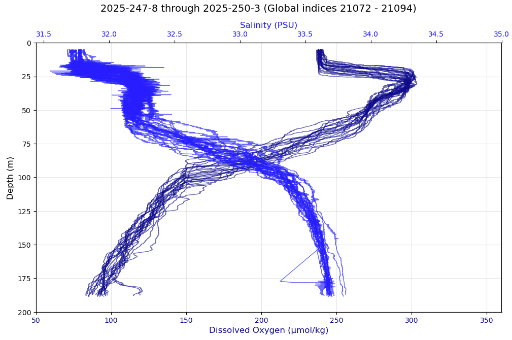
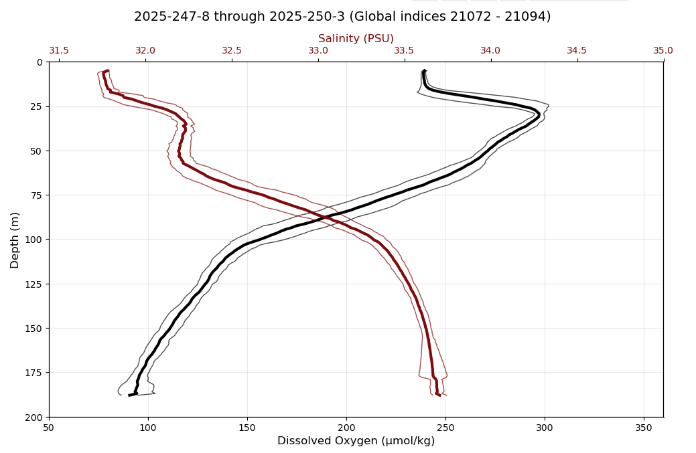
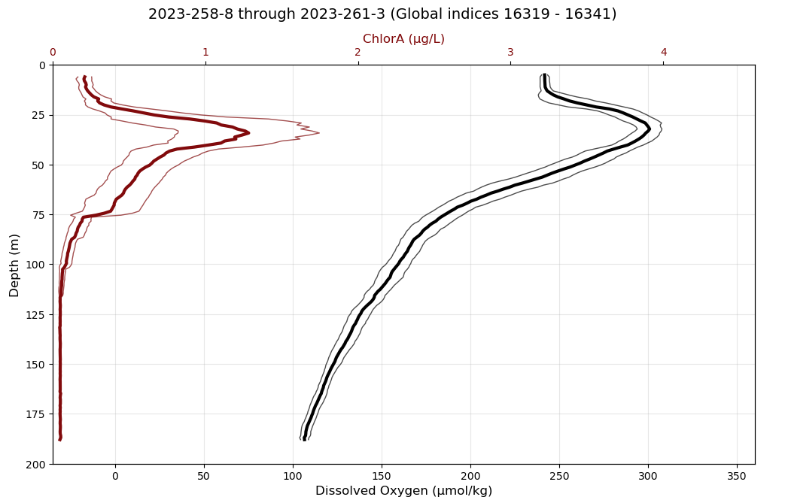

# SOM: the subsurface oxygen maximum below the mixed layer

This folder `~/argosy/som` concerns the **subsurface oxygen maximum (SOM)** apparent in shallow profiler data: a dissolved
oxygen (DO) inversion just below the mixed layer depth (MLD).

## The observation

In many profiles, dissolved oxygen concentration (DO) rises sharply by perhaps 60 umol/kg just below the MLD, with a sharp reverse cline somewhere around 15 to 40 m. This layer has some thickness (typically tens of meters) whereupon continuing downward the profile returns along a normal cline past the mixed-layer value. The DO concentration continues to drop, more steeply, past 100 meters. This was noticed as a persistent feature while labeling Slope Base MLDs for October 2024. From `MLDObservations.md` (Rob, 04-NOV-2026):

> sb GPI 18478 to 18493 to 15-OCT (18610) and beyond, stable: DO. Persistent inversion signal continues at varying strengths to 18747, the last GPI of October.

## Example charts

These bundle charts overlay a consecutive series of profiles. Titles read `year-dayofyear-dailyindex` (profile of
the day), then the range of global profile indices (GPI).

*23 consecutive profiles at Slope Base, 4 -- 7 September 2025. DO (dark, bottom axis) and
salinity (blue, top axis) against depth. A fresh surface layer (salinity about 31.8, DO about 240
umol/kg) ends near 20 to 25 m. Just below it DO jumps to about 300 umol/kg while salinity is about
32.2. DO then falls to about 90 umol/kg at 185 m.*

*The same profiles reduced to a mean (thick line) with the spread about it (thin lines: mean plus
and minus one standard deviation across the profiles at each depth, on a common depth grid; see
`vis/bundle_chart.py`). The thin lines stay close together at the DO maximum near 30 m: the
feature is stable across the three days.*

*A different bundle (about 15 to 18 September 2023): mean DO (black) and chlorophyll-a (dark red,
top axis). Chlorophyll is near zero above 20 m and below 75 m and peaks near 33 m, at the same
depth as the DO maximum (about 300 umol/kg).*

Reading the examples (provisional; two bundles, no temperature shown):

- In September 2025 the maximum sits directly under a fresh surface layer. The stratification that
  isolates the layer may come from that fresh lens (plume water), which would let oxygen
  accumulate below it.
- In September 2023 a chlorophyll maximum coincides with the DO maximum: a "Yes" in the production
  column of the test table below. Fluorometer chlorophyll has known calibration biases, so trust
  the depth coincidence more than the value.
- None of this shows percent saturation. That needs temperature along with salinity and DO, and is
  the next test.

## What it is

A local oxygen maximum below the mixed layer is a known feature of stratified water, called a
subsurface oxygen maximum. Not yet checked against the full papers (found by search only):

- Shulenberger and Reid (1981), *Deep-Sea Research A* 28, 901: Pacific summer SOM with saturation
  of 120% or more, below the productivity maximum.
- Jenkins and Goldman (1985), *J. Marine Research*: Sargasso Sea SOM within the euphotic zone,
  argued to be of photosynthetic origin.
- "Extremes of Dissolved Oxygen in the California Current System" (arXiv:2408.12287): hypothesizes
  photosynthesis raises DO in subsurface water that cannot ventilate to the surface.
- A Canada Basin oxygen study (citing Timmermans et al. 2010): the SOM coincides with the remnant
  winter mixed layer.
- Related methods: Plant et al. (2016), *Global Biogeochem. Cycles* 30, 859, and Pelland et al.
  (2018), *JGR Oceans* 123 (net community production from oxygen at Ocean Station Papa).

## Four ways to make an oxygen maximum below the MLD

1. **Production in place.** Photosynthesis at the base of the lit layer adds oxygen. Stratification
   keeps it from reaching the atmosphere, so it accumulates. The mixed layer above exchanges gas
   with the air and stays near equilibrium.
2. **Remnant.** As the mixed layer shoals in summer, the water left below keeps the oxygen it had
   in contact with the atmosphere (often cooler, so richer). It fades slowly by respiration and
   mixing.
3. **Temperature (solubility).** Colder water holds more oxygen at equilibrium: roughly 5 umol/kg
   per deg C near 10 to 15 deg C (approximate; compute exactly). A layer 6 deg C cooler than the
   mixed layer could show about 30 umol/kg more with no biology: about half of 60.
4. **Sideways supply.** A different water mass slides in: Columbia plume or offshore water at Slope
   Base in September to October.

The gradual return to the mixed-layer value near 70 m fits all four: below the lit layer,
respiration steadily consumes oxygen, which builds the low-oxygen zone at depth.

## Telling them apart (with data already in hand)

| Test | Production | Remnant | Temperature only | Sideways |
|---|---|---|---|---|
| DO as % saturation (not umol/kg) | Above 100% | Near or below 100% | Same as mixed layer | Either |
| T-S diagram: same curve as the mixed-layer water? | Yes | Yes | Yes | No |
| Chlorophyll or backscatter maximum at that depth | Yes | No | No | Maybe |
| Midnight (#4) vs post-noon (#9) profile at that depth | DO higher in the afternoon | No daily change | No daily change | Not systematic |
| pH or pCO2 at that depth | Higher pH, lower pCO2 | The earlier signature | No anomaly | Varies |

First rule out **sensor artifacts**: a response or thermal lag in a strong thermocline can create a
few umol/kg of false structure, but not 60. Convert to percent saturation before interpreting,
because that removes the temperature effect.

## Is it primary production if the inversion persists through November?

Not on this evidence, and persistence cuts against it. By November at 44.5 N the light at 20 to
30 m is weak and storms stir the layer. An inversion that stays stable for weeks looks more like an
isolated remnant, or a sideways-supplied layer, than active photosynthesis. Production may
contribute early in the season. Treat it as one candidate among four. The most direct test is the
diel one: DO at the inversion depth on profile #9 minus profile #4 (watch for aliasing by internal
tides, since the two profiles are about 13 hours apart).

## Open topics

- *Done:* the three bundle-chart PNGs are in `~/argosy/images` and embedded above.
- **Annotate the time intervals with a high-oxygen inversion.** Not started. Either automated (?)
  or by hand using the bundle chart. An automated version would measure, per profile, the DO
  maximum below the labeled MLD minus the DO at the MLD, and call a run of consecutive profiles
  above a threshold an interval; the by-hand version marks intervals while looking at bundle
  charts. Decide which, or both (compare the automated result against the hand annotation).
